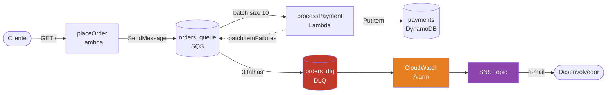

# SQS Course


Projeto serverless na AWS demonstrando processamento assíncrono de pedidos com SQS, DLQ, DynamoDB e tratamento de falhas parciais em batch.

## Arquitetura



## Stack

| Camada | Tecnologia | Versão |
| --- | --- | --- |
| Runtime | Node.js | 24.x (arm64) |
| Linguagem | TypeScript | 7.x |
| Framework | Serverless Framework + esbuild | latest |
| Fila | Amazon SQS | — |
| Banco de dados | Amazon DynamoDB | — |
| AWS SDK | `@aws-sdk/client-sqs`, `@aws-sdk/client-dynamodb`, `@aws-sdk/lib-dynamodb` | v3 |
| Validação de env | Zod | 4.x |
| Linting | Biome | 2.x |
| Package manager | pnpm | 11.x |
| Git hooks | Husky + lint-staged + commitlint | — |

## Recursos AWS provisionados

| Recurso | Nome | Configuração |
| --- | --- | --- |
| SQS Queue | `orders_queue` | Long polling 20s · redrive após 3 falhas |
| SQS DLQ | `orders_dlq` | Long polling 20s · retenção 14 dias |
| DynamoDB Table | `payments` | `PAY_PER_REQUEST` · PITR habilitado |
| CloudWatch Alarm | `orders-dlq-messages-visible` | Período 60s · threshold > 0 mensagens visíveis |
| SNS Topic | `DLQAlarm` | Assinatura por e-mail ao disparar o alarme |

## Setup

### Pré-requisitos

| Ferramenta | Versão mínima |
| --- | --- |
| Node.js | 24+ |
| pnpm | 11+ |
| AWS CLI | 2+ |
| Serverless Framework | 4+ |

### Instalação

```bash
git clone <repo-url>
cd sqs-course
pnpm install
```

### Credenciais AWS

```bash
aws configure
```

### Deploy

```bash
# desenvolvimento
pnpm dlx serverless deploy

# produção
pnpm dlx serverless deploy --stage prod
```

> As variáveis de ambiente são injetadas automaticamente via referências CloudFormation — não é necessário configurá-las manualmente.
